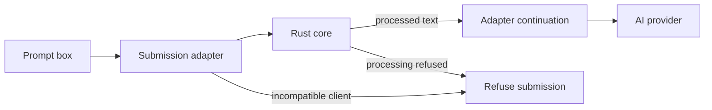

# 1. User-controlled prompt boundary

Date: 2026-10-12

## Status

Accepted. Rust owns local transformation; Claude Code supplies the qualified
submission adapter. [ADR 4](0004-consented-local-traces.md) supersedes only this
record's blanket persistence prohibition, permitting consented local inspection.
[ADR 2](0002-release-and-quality-evidence.md) owns release evidence;
[ADR 3](0003-future-egress-enforcement.md) owns the network gateway boundary.

## Context

A draft is unsent text in a host's prompt box. An adapter submits that text to
Savior's local core, which detects phrases and selects ranges called spans for
replacement. An edit can be unsafe when a span overlaps protected code or quoted
material. Keeping these rules independent of the host lets another adapter reuse
the same transformation contract.

The diagram follows one supported submission through a loaded adapter. Refusal
does not forward text; draft recovery remains the host's responsibility. Other
host traffic and unsubmitted drafts outside Savior's process are not covered.
This boundary gives Savior no control over provider policy.

## Decision

Rust owns detection, span normalization, protected-text checks, replacement,
and content-free errors. Adapters transport requests and results; new adapters
must preserve this contract rather than duplicate text semantics.

The supported path is a non-slash submission whose `prompt.submit` origin is
`composer`, the host's name for the prompt box. Only successfully processed text
continues; failures refuse the submission. This is the **verified mod boundary**,
scoped to the client, artifact, and cases tested.
Slash commands, programmatic origins, tools, and earlier host records are outside
it. Claude packages this mod as a plugin; those names refer to one integration.

Rewriting `session.append` would include conversation content beyond the user's
draft. It requires its own field and origin contract, fidelity tests, and
compatibility with managed host policies. Network interception and whole-host
egress control likewise need separate evidence under ADR 3.

### Client API compatibility

Qualify exact client versions and their draft lifecycle. Similar version numbers
and release discovery do not grant support. Unknown versions, ambiguous matches,
and failed version probes refuse supported submissions before processing.
Select compatible entry modules before parsing or registering them; share an
adapter only after qualifying the same API and draft behavior.

These checks operate inside a loaded adapter. If the host cannot load it or
register refusal, the mod cannot block submissions. Installation alone never
establishes protection. The [compatibility guide](../releases.md#client-compatibility)
owns version mappings, selection mechanics, and qualification procedures.

## Invariants & Abstention

- Forward transformed content only after successful processing. Protected-span
  conflicts, malformed requests, incompatible artifacts, and processing failures
  block the attempt; none permits an original-text fallback.
- Preserve unmatched text exactly. Runtime inference stays local and offline.
- Leave draft recovery to the qualified host. Savior must not read or fill the
  prompt box on refusal, overwrite newer input, or revive cancelled work.
  Verify retention and an exact retry in the actual client; a handler's refusal
  result alone does not establish draft retention or provider receipt.
- Original prompts never enter logs, errors, or training data. Persistence is
  prohibited except under ADR 4's separate consent and retention contract.
- A disabled or bypassed adapter provides no protection. Detection can miss
  unwanted language or select harmless text; the core cannot guarantee delivery,
  complete host privacy, or provider acceptance.

## Consequences

Visible refusal lets the user resolve a failed edit. Sharing Rust semantics
makes adapters replaceable, but each host still needs API and draft-recovery
qualification. Claims remain limited to the paths actually tested.

### Open questions

Which other hosts can preserve this boundary? What reviewed evidence supports
stronger detection claims? Can independent egress control resist bypass across
platform failures? These questions remain unresolved.

### Related mod designs

The [compatibility guide](../releases.md#related-mod-designs) preserves the
upstream interface and related designs. The
[dated host evidence](../evaluation.md#claude-21322-interception-check) records
why the qualified host owns draft recovery; requalify that behavior when changing
the client pin. Neither handler mocks nor another mod's tests qualify Savior's
delivery or coverage.
