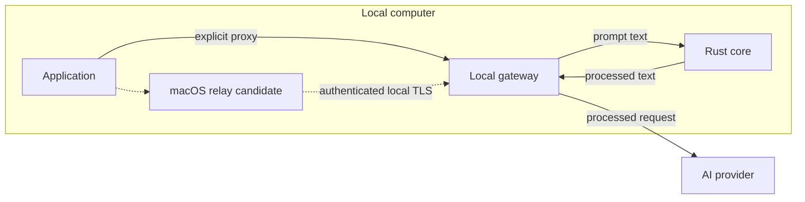

# 3. Local network prompt gateway

Date: 2026-10-20

## Status

Accepted for implementation. The gateway remains a development path; native
enforcement and real-client qualification are incomplete. Acceptance does not
establish complete egress coverage or authorize host activation. The
[network guide](../network.md#implementation-status) owns implementation status
and deferrals. ADR 1's qualified Claude mod boundary remains separate.

## Context

A gateway receives a client's request before forwarding it to a provider.
Egress is traffic leaving the machine. A gateway can serve several clients
without changing their interfaces, but intercepting one path does not establish
control over every outbound route.

Solid arrows show the explicit development proxy path. Dashed arrows show the
unactivated macOS routing candidate. Independent blocking is not depicted: it
remains unimplemented, so this diagram does not establish bypass resistance.

Host mods offer a smaller transport boundary but depend on host APIs. Debugging
proxies such as `mitmproxy` help inspect traffic, yet do not supply prompt-origin
qualification or persistent bypass resistance. Browser extensions cover browser
traffic rather than independent desktop clients. A native gateway broadens the
possible client surface at the cost of TLS, transport, and OS responsibilities.

## Decision

Use a shared Rust gateway built with Tokio, Hyper, and Rustls. It buffers a
supported request, extracts newly submitted user prompt text, calls the existing
Rust core, validates the reconstructed request, and only then forwards it.
History, instructions, tools, and attachments remain outside the transformation;
code and quotation protection retain [ADR 1's contract](0001-local-span-replacement.md).

The gateway owns TLS termination, upstream validation, HTTP structure,
compression, framing, streaming, and certificates. The core owns detection,
source offsets, protection, and replacement. Native companions own privileged
routing, blocking, and OS lifecycle; the gateway and detector run unprivileged.

The macOS relay authenticates the local gateway through TLS anchored to the
installation's CA before forwarding application TLS bytes. Its upstream
exemption requires the configured gateway's signed code identity.

## Invariants & Abstention

- Preserve supported non-text fields. Never apply source offsets to serialized
  HTTP or JSON bytes.
- Withhold unsupported or ambiguous requests, protected-span conflicts, and
  processing failures. Transport failures never trigger original-text retries.
- Demonstrate compatibility with real clients. Synthetic canaries and an
  independently controlled receiver must observe transformed supported requests.
- Before advertising support, qualify request fidelity, transport behavior,
  certificate trust, and proxy lifecycle through the
  [release gates](../network.md#remaining-release-gates).
- Interception does not prove complete coverage. Stronger egress claims require
  independent bypass resistance, authenticated privileged control, lifecycle
  containment, and platform-native tests.

## Consequences

The gateway can reuse one transformation core across transports, but must track
provider formats, HTTP versions, QUIC or opaque traffic, trust configuration,
routing changes, privileges, and OS updates. Client support and bypass resistance
require separate evidence; neither follows from a correct local replacement.

### Open questions

Which client request formats can be reconstructed without changing their
meaning? Which platform controls can contain alternate outbound routes? Those
questions need client and platform evidence before support can be advertised.

The [network guide](../network.md) owns setup and implementation limits;
[ADR 2](0002-release-and-quality-evidence.md) distinguishes observed delivery
from claims about all traffic leaving the host.
