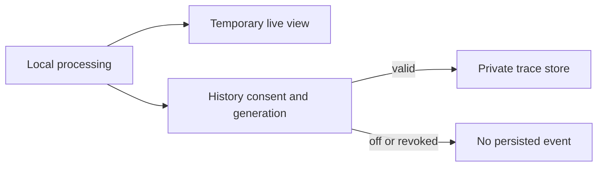

# 13. Require consent for all trace history

Date: 2026-11-27

## Status

Accepted. Supersedes only ADR 4's permission to retain text-free outcome records
without history consent. Its processing, local viewing, retention, and deletion
boundaries remain in force.

## Context

An outcome without prompt text can still reveal a person's activity. A control
that stops full-text storage while retaining outcomes does not meet the selected
company policy that optional history defaults off. Local viewing and personal
review serve separate purposes and already have separate controls.

## Decision

The Rust trace store requires history consent for every new event, including
failures and cancellations. It checks the consent generation in the same
transaction as the insert. Disabled or stale consent skips the entire record
rather than retaining a text-free substitute.

A separate metadata-history control would add another consent choice for the
same retrieval purpose. Retaining outcomes automatically would continue the
privacy mismatch. The existing history choice therefore gates the whole record.

Observation IDs identify live activity independently of storage. A skipped
record is a normal outcome, not a recording failure. A saved trace ID is returned
only after successful storage. Unavailable storage or consent evidence still
reports a recording gap without changing the rewrite result.

## Invariants & Abstention

- New installations and declined consent persist no optional trace events.
- Revocation wins over work admitted under an earlier generation, including
  after consent is enabled again. No downgrade to metadata is permitted.
- Existing explicit consent remains valid for its existing history purpose;
  it grants no remote analytics or upload permission.
- Existing records are neither silently deleted nor reclassified. They remain
  subject to the existing seven-day policy, capacity ceiling, and deletion.
- Live viewing, content-free diagnostics, necessary settings, and separately
  consented personal-review metrics retain their own boundaries.
- Missing consent evidence never authorizes recording. Rewriting remains offline
  and never falls back to forwarding original text after processing failure.

## Consequences

The history control describes all trace persistence. Users who decline it retain
temporary live visibility but cannot retrieve unsaved outcomes later. Store
files and settings may still exist without event rows. Retained files remain
unencrypted by Savior; this decision does not establish administrator resistance.
