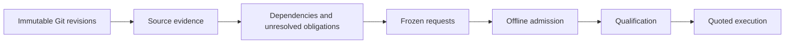

# Offline context-planning refactor

A review plan assigns changed source to requests and supplies the dependencies
needed to interpret each change. This refactor repairs two boundaries: deciding
which source is required, and admitting a plan before any paid work.

The independent-function regression now packs with complete declared evidence.
PR #19 still cannot complete automatically: dynamic dependencies and oversized
evidence sets remain unresolved. The repaired admission path rejects that plan
before qualification. No provider calls were made for this work.

## Two architectural failures

The old planner used original diff hunks and file-name relationships as dependency
evidence. After splitting a large addition, each piece still required its original
siblings, while an 8 kB support cap omitted them. A synthetic file containing 240
independent functions produced gaps in both baseline chunks and all 32 adaptive
chunks. The new source graph produces eight complete chunks in either strategy.
The larger baseline count pays for complete source and verification headroom;
chunk count alone is not an optimization target.

Admission was also too late. In CI run
[43356310204](https://github.com/yourmoodai/savior/actions/runs/43356310204),
qualification passed before execution discovered that neither PR plan was
feasible. The saved usage records contain 103 calls, 146,942 input tokens,
17,377 output tokens and $0.12325149 in usage-priced cost. The $43.23213312
qualification projection was a reservation scenario, not that cost. No PR
chunks were assessed, and the final report mislabeled planning failure as an
infrastructure failure.

## Implemented boundaries



Regular Git blobs supply old and new source without executing repository code.
Pinned Tree-sitter grammars identify declarations and imports in Python, Rust,
JavaScript and TypeScript. JSON records and Markdown sections provide additional
boundaries. A worklist computes transitive source obligations, including unchanged
helpers. Each changed location has one primary owner; context is separate evidence.

Requests retain their required source, explicit gaps and bounded verification
headroom. The frozen plan binds revisions, analyzer versions, graph edges,
locations and messages. Preflight checks feasibility before qualification lookup;
execution validates quoted artifacts before qualification and consumes the selected
frozen requests. `planning_failed` preserves the reason without suggesting that
more spending would repair it. Changed analyzers invalidate qualification caches.

## Frozen PR replay

The [result artifact](context-planning-results.json) records the same PR head
(`a130b948abcb218674aa152e8f9a09e54b021742`), merge base
(`3575521a329b3368593421419f7587b8441f1c3a`) and CI status snapshot used by the saved
failure. The requested base was main at
`df4a92a44729ca7bf1f78a62ad19b04ab2331749`; Git's merge base differs because of the
previous stack merge. All four plans preserve the same 8,860 primary locations
exactly once across 34 changed files.

| Planner | Chunks | Chunks with gaps | Request input units | Supporting bytes |
| --- | ---: | ---: | ---: | ---: |
| Historical baseline | 47 | 46 | 1,352,127 | 216,308 |
| Historical adaptive | 41 | 41 | 1,287,194 | 227,756 |
| Source baseline | 48 | 34 | 2,801,330 | 1,652,785 |
| Source adaptive | 47 | 34 | 2,787,916 | 1,652,785 |

Input units are UTF-8 bytes plus template allowances, not measured model tokens.
The source plans include previously absent unchanged dependencies and use stronger
verification headroom. Their larger inputs are therefore not an equivalent-evidence
cost comparison. All four PR plans are infeasible. The artifact's hypothetical
reservation totals must not be read as savings, actual spending or executable
alternatives. This replay spent $0.

The local passes took approximately 1.4–2.5 seconds with 2.5–26.9 MB of peak traced
Python allocations. These are single-run diagnostics under concurrent local
validation, not a latency benchmark or total process/native-parser memory.

Reproduce without inference after installing the pinned reviewer requirements:

```sh
npm run reviewer:experiment -- context-audit \
  --base df4a92a44729ca7bf1f78a62ad19b04ab2331749 \
  --head a130b948abcb218674aa152e8f9a09e54b021742 \
  --test-evidence .cache/context-test-evidence.json \
  --output .cache/context-audit.json
```

Extract `test_evidence` from the result artifact into the named input file to
reproduce the status context. Omit `--test-evidence` for a source-only comparison;
chunk counts will differ. The runner refuses provider invocation and never writes
qualification results.

## Validation and limits

Twenty-two source-plan tests exercise four-language helper dependencies, aliases,
re-exports, defaults, shadowed parameters, cycles, deletions and renames, Unicode
coordinates, non-code records, missing source, syntax errors, dynamic calls,
unsupported imports and oversized closures. Mutation tests reject duplicate
ownership, moved coordinates, removed dependencies and changed messages. Mocked
execution proves that quoted requests are restored without repacking and that
planning rejection precedes qualification and reservations.

The complete local reviewer suite passed 206 tests and the research suite passed
29. Build, repository verification and workflow lint passed. Repository verification
retains two existing optional Node native-test skips and one ignored Rust test;
it does not establish every
platform's behavior. These are implementation checks and constructed regression
oracles, not unseen quality evaluation or evidence of model equivalence.

This analysis is deliberately narrower than a compiler. It does not prove dynamic
dispatch targets, expand Rust macros, resolve build-system aliases, model all
language scopes or inspect external packages. Rust grouped/glob imports and Python
multiline imports currently produce explicit gaps. Unsupported file formats
receive exact textual evidence only. Conservative top-level effects can pull in
large modules. A finite closure means the declared graph was traversed; it does
not prove the graph includes every runtime dependency.

## Reading applied

The supplied *Principles of Program Analysis* material on fixed points and monotone
dataflow frameworks (PDF pages 45 and 95) informs the separation between evidence,
dependency constraints and their closure. The useful invariant is preservation of
required information through placement. This implementation does not claim the
soundness guarantees of a formal abstract interpretation.

*Essential Math for AI* discusses graph representations and constrained optimization
(PDF pages 333 and 388). Applied here, capacity and evidence obligations are
constraints; request count and cost are secondary objectives. An infeasible cheap
packing is not a candidate for selection.

*Towards AI That Improves Itself: A Survey of Recursive Self-Improvement* discusses
frozen replay, held-out evaluation and resource-controlled comparisons (PDF pages
8 and 34). This motivates retaining the failed CI snapshot and separating structural
regressions from future model-quality trials. These examples informed development
and cannot serve as an unbiased held-out set. Only the relevant sections of the
three supplied PDFs were examined.

[Tree-sitter's parsing documentation](https://github.com/tree-sitter/tree-sitter/blob/master/docs/src/using-parsers/2-basic-parsing.md)
describes syntax trees and source positions. Those capabilities justify source
extraction; they do not establish type resolution or semantic completeness.

## Follow-up order

First review this consolidated PR and the explicit abstention boundaries in
[ADR 10](../adr/0010-freeze-review-evidence-before-inference.md). Resolve the most
common unsupported local imports and receiver types with independent dependency
oracles before attempting another paid run. Avoid reducing gaps merely by
discarding obligations.

Next freeze unseen dependency variants, including helper placement, aliases and
distractors, and compare only plans with equivalent required evidence. A later
authorized model trial should measure complete coverage, finding validity,
misses, false positives, latency, usage-priced cost and outstanding reservations
separately. CPU model routing remains subordinate to those measurements.
